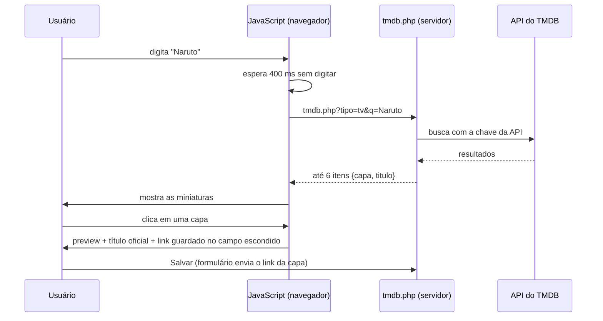
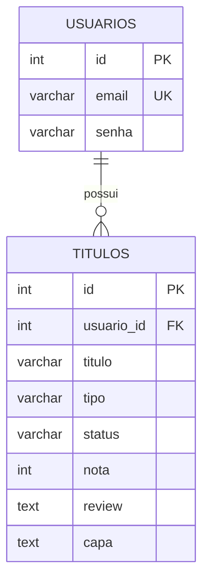

# StreamList

Aplicação web para organizar filmes e séries, desenvolvida em PHP e PostgreSQL. Cada usuário cria uma conta, monta a sua própria **vitrine** de títulos (com capa, status, nota e review) e acompanha o que quer assistir, está assistindo ou já assistiu. As capas são sugeridas automaticamente a partir da API do TMDB conforme o título é digitado.

## Funcionalidades

- Cadastro de usuário com e-mail e senha armazenada com `password_hash()`.
- Login e logout com sessão PHP.
- Proteção das páginas internas: visitantes não autenticados são redirecionados para o login.
- Cadastro de filme ou série com título, tipo, status, nota (1 a 10) e review.
- Sugestão de capas pela API do TMDB enquanto o título é digitado, com pré-visualização da capa escolhida.
- Ao escolher uma capa, o campo de título é preenchido com o nome oficial retornado pela API.
- Vitrine com cartões que mostram capa, selo de status, nota, tipo e review.
- Busca de título pelo nome através da barra de pesquisa na vitrine.
- Edição de status, nota, review e capa de um título.
- Exclusão de título com tela de confirmação.
- Aviso quando o usuário tenta adicionar um título que já existe na sua vitrine.
- Isolamento entre usuários: cada pessoa só vê, edita e exclui os próprios títulos.
- Interface responsiva, que se adapta a telas de celular.

## Tecnologias

- PHP
- PostgreSQL
- PDO com o driver `pdo_pgsql`
- cURL (PHP) para consultar a API do TMDB
- JavaScript (`fetch`) para a busca de capas
- HTML
- CSS

---

## 1. Como Executar o Projeto

Os comandos abaixo funcionam em qualquer terminal Linux: servidor acessado pelo **MobaXterm (SSH)**, WSL, máquina virtual ou o próprio computador.

### 1.1 Pré-requisitos

- **PHP 7.4 ou superior** com as extensões:
  - `pdo_pgsql` (conexão com o PostgreSQL)
  - `curl` (consulta à API do TMDB)
- **PostgreSQL** instalado e em execução na porta padrão `5432`.
- **Git** instalado.
- Conexão com a internet (para buscar as capas no TMDB).

Para instalar tudo em Ubuntu/Debian:

```bash
sudo apt update
sudo apt install -y git php php-cli php-pgsql php-curl postgresql postgresql-contrib
```

Para conferir se as extensões estão ativas:

```bash
php -m | grep -E "pdo_pgsql|curl"
```

### 1.2 Passo 1: Clonar o repositório

```bash
# Clone o repositório já com a pasta em minúsculas
git clone https://github.com/joaohso19/streamlist.git

# Acesse a pasta do projeto
cd streamlist
```

> **Importante:** os links do sistema usam o caminho `/streamlist/...` (em minúsculas). No Linux, `StreamList` e `streamlist` são pastas diferentes, por isso a pasta do projeto **precisa se chamar `streamlist`**. O nome no final do comando garante isso.

### 1.3 Passo 2: Criar o banco de dados e o usuário

**1 -** Entre no PostgreSQL com o usuário administrador `postgres`:

```bash
sudo -u postgres psql
```

**2 -** Dentro do `psql`, crie o usuário da aplicação:

```sql
CREATE USER streamlist_user WITH PASSWORD 'stream';
```

> `stream` é uma senha de exemplo para testes. Em um ambiente real, use uma senha própria e a mesma no Passo 4.

**3 -** Crie o banco de dados tendo esse usuário como dono:

```sql
CREATE DATABASE streamlist OWNER streamlist_user;
```

Se o banco já existir e você quiser recriá-lo do zero (isso **apaga todos os dados**):

```sql
DROP DATABASE IF EXISTS streamlist;
CREATE DATABASE streamlist OWNER streamlist_user;
```

**4 -** Conecte-se ao banco criado. Digite este comando **sozinho**, aperte Enter e só depois continue:

```sql
\c streamlist
```

> Se você colar o `\c` junto com outros comandos, o `psql` interpreta o resto como parte da conexão e dá o erro `invalid integer value ... for connection option "port"`.

**5 -** Conceda as permissões ao usuário:

```sql
GRANT ALL PRIVILEGES ON DATABASE streamlist TO streamlist_user;
GRANT ALL ON SCHEMA public TO streamlist_user;
```

**6 -** Saia do `psql`:

```sql
\q
```

> As tabelas serão criadas no próximo passo **pelo próprio `streamlist_user`**, que já será dono delas, então não é preciso conceder permissão tabela por tabela. Se você preferir executar o `schema.sql` como `postgres`, depois dê as permissões com:
> ```sql
> GRANT ALL PRIVILEGES ON ALL TABLES IN SCHEMA public TO streamlist_user;
> GRANT ALL PRIVILEGES ON ALL SEQUENCES IN SCHEMA public TO streamlist_user;
> ```
> As permissões em `SEQUENCES` são necessárias porque os campos `id` usam `SERIAL`: sem elas o cadastro falha.

### 1.4 Passo 3: Criar as tabelas (`schema.sql`)

Com o terminal na pasta do projeto, execute o arquivo `schema.sql`. O PostgreSQL vai pedir a senha do `streamlist_user`:

```bash
psql -U streamlist_user -h localhost -d streamlist -f schema.sql
```

> O `-h localhost` força a conexão por senha, evitando o erro de autenticação "peer". Digite o usuário exatamente como foi criado (minúsculas): o PostgreSQL converte nomes sem aspas para minúsculas na criação, mas o `-U` respeita o que você digitar.

Para conferir se as tabelas foram criadas:

```bash
psql -U streamlist_user -h localhost -d streamlist -c "\dt"
```

Resultado esperado: as tabelas `usuarios` e `titulos`.

### 1.5 Passo 4: Configurar a conexão no PHP

**1 -** Na pasta `database`, abra o arquivo `connect.php`:

```bash
nano database/connect.php
```

**2 -** Altere as credenciais para as do seu ambiente (as mesmas criadas no Passo 2):

```php
$host = 'localhost';
$port = '5432';
$dbname = 'streamlist';
$user = 'streamlist_user';
$password = 'stream';
```

Para salvar no `nano`: `Ctrl + O`, Enter, `Ctrl + X`.

**3 -** Chave da API do TMDB: ela fica na variável `$chave` do arquivo `app/tmdb.php`. Se as capas pararem de aparecer, crie uma conta gratuita em [themoviedb.org](https://www.themoviedb.org/), gere uma chave própria e substitua o valor. Sem uma chave válida o sistema continua funcionando, mas sem sugestão de capas.

### 1.6 Passo 5: Iniciar o servidor

Saia da pasta do projeto: o servidor deve ser iniciado na pasta **anterior** a `streamlist`.

```bash
cd ..
```

**Testando na própria máquina:**

```bash
php -S localhost:8000
```

Acesse `http://localhost:8000/streamlist/login/login.php`.

**Em um servidor acessado pelo MobaXterm (SSH):** o `localhost` do navegador é o seu computador, não o servidor. Inicie o PHP aceitando conexões externas:

```bash
php -S 0.0.0.0:8000
```

Acesse `http://IP_DO_SERVIDOR:8000/streamlist/login/login.php`.

Se a porta estiver bloqueada pelo firewall, libere-a com `sudo ufw allow 8000` ou use um **túnel SSH** do MobaXterm (*Tunneling → New SSH tunnel*, porta local `8000` para `localhost:8000` do servidor) e acesse normalmente por `localhost:8000`.

Para manter o servidor ativo mesmo fechando a sessão SSH:

```bash
nohup php -S 0.0.0.0:8000 > servidor.log 2>&1 &
```

> Se o servidor já tiver Nginx ou Apache configurado com PHP apontando para `/var/www/html`, não é preciso usar o `php -S`: basta acessar `http://IP_DO_SERVIDOR/streamlist/login/login.php`.

### 1.7 Passo 6: Primeiro acesso

1. Abra a tela de cadastro (`/streamlist/login/cadastrar.php`).
2. Informe e-mail e senha e clique em **Cadastrar**.
3. Você será redirecionado ao login; entre com a conta criada.
4. Use **Adicionar** para incluir o primeiro filme ou série.

### 1.8 Problemas comuns

| Erro | Causa provável | Solução |
|---|---|---|
| `could not find driver` | Extensão `pdo_pgsql` ausente | `sudo apt install php-pgsql` |
| `password authentication failed` | Usuário ou senha diferentes entre o PostgreSQL e o `connect.php` | Conferir as credenciais; para redefinir: `ALTER USER streamlist_user WITH PASSWORD 'nova_senha';` |
| `permission denied for table` / `sequence` | Permissões não concedidas | Refazer os `GRANT` do Passo 2 |
| `Call to undefined function curl_init()` | Extensão `curl` ausente | `sudo apt install php-curl` |
| `ERR_CONNECTION_REFUSED` no navegador | Servidor PHP parado, ou acessando `localhost` de outra máquina | Conferir se o `php -S` está rodando e usar o IP do servidor ou o túnel SSH |
| Página 404 em `/streamlist/...` | Servidor iniciado dentro da pasta do projeto, ou pasta com nome diferente de `streamlist` | Iniciar o `php -S` na pasta anterior e renomear com `mv StreamList streamlist` |
| Capas aparecem como imagem quebrada | Arquivos `tmdb.php` e `create.js` em versões diferentes | Atualizar os dois e recarregar com `Ctrl + F5` |
| Capas não aparecem | Chave do TMDB inválida ou servidor sem internet | Conferir `$chave` em `app/tmdb.php` e a conexão do servidor |

---

## 2. Estrutura do Projeto

```
streamlist/
├── app/
│   ├── create.php        # adicionar título (PHP + HTML)
│   ├── read.php          # vitrine (listagem e busca por nome)
│   ├── update.php        # editar título
│   ├── delete.php        # excluir título
│   └── tmdb.php          # "ponte" para a API do TMDB (devolve capas em JSON)
├── assets/
│   ├── style.css         # estilos (tema escuro)
│   ├── capas.js          # funções de busca de capas (buscaFilmes, buscaSeries)
│   └── create.js         # comportamento da tela de adicionar
├── database/
│   └── connect.php       # conexão PDO com o PostgreSQL
├── includes/
│   ├── functions.php     # funções de acesso ao banco
│   ├── header.php        # cabeçalho comum
│   └── footer.php        # rodapé comum
├── login/
│   ├── login.php         # entrada do usuário
│   ├── cadastrar.php     # cadastro de usuário
│   └── verifica_user.php # protege as páginas (exige sessão)
├── logo-icone.svg        # ícone do site
├── schema.sql            # criação das tabelas
└── README.md
```

---

## 3. Como Funciona a Busca de Capas (JavaScript)

A vitrine (`read.php`) não usa JavaScript: a busca por nome recarrega a página e o PHP monta a lista. O JavaScript é usado nas telas de **adicionar** e **editar**, para sugerir capas sem recarregar a página.

| Arquivo | Papel |
|---|---|
| `assets/capas.js` | Faz o `fetch` ao `tmdb.php`. Tem `buscaFilmes(nome)` e `buscaSeries(nome)` |
| `assets/create.js` | Comportamento da tela de adicionar: mostra/esconde a nota, busca capas ao digitar, mostra as miniaturas e guarda a capa escolhida |
| `app/tmdb.php` | Recebe o pedido do JS, consulta o TMDB com a chave da API e devolve até 6 capas |

O JavaScript chama o `tmdb.php` (e não o TMDB direto) para que a **chave da API não fique exposta** no navegador.



Formato da resposta do `tmdb.php`:

```json
[
  { "capa": "https://image.tmdb.org/t/p/w500/abc123.jpg", "titulo": "Naruto" },
  { "capa": "https://image.tmdb.org/t/p/w500/def456.jpg", "titulo": "Naruto Shippuden" }
]
```

O banco guarda **apenas o link** da capa (texto), não a imagem. O JS só preenche o campo escondido `capa`; quem grava no banco é o PHP, quando o formulário é enviado.

---

## 4. Requisitos e Regras de Negócio

### 4.1 Requisitos Funcionais (RF)

| ID | Requisito | Descrição |
|---|---|---|
| **RF01** | Cadastro de Usuários | O sistema deve permitir que novos visitantes se cadastrem informando e-mail e senha. |
| **RF02** | Autenticação e Sessão | O sistema deve permitir login e logout de usuários registrados, mantendo a sessão ativa. |
| **RF03** | Proteção de Rotas | O sistema deve bloquear o acesso de visitantes não autenticados às páginas internas (`create`, `read`, `update`, `delete`). |
| **RF04** | Cadastro de Títulos | O sistema deve permitir cadastrar filmes e séries com título, tipo, status, nota (opcional) e review (opcional). |
| **RF05** | Integração com API de Capas | O sistema deve buscar e sugerir capas em tempo real utilizando a API externa do TMDB enquanto o usuário digita o título. |
| **RF06** | Exibição da Vitrine | O sistema deve listar os títulos do usuário em formato de cartões (cards) contendo capa, selo de status, nota, tipo e review. |
| **RF07** | Busca por Nome | O sistema deve permitir pesquisar títulos pelo nome diretamente na vitrine. |
| **RF08** | Edição de Título | O sistema deve permitir alterar o status, a nota, o review e a capa de um título já cadastrado. |
| **RF09** | Exclusão com Confirmação | O sistema deve permitir excluir um título mediante uma tela de confirmação antes de remover do banco de dados. |
| **RF10** | Isolamento de Dados | O sistema deve restringir a visualização, edição e exclusão apenas aos títulos pertencentes ao usuário logado. |

### 4.2 Requisitos Não-Funcionais (RNF)

| ID | Requisito | Categoria | Descrição |
|---|---|---|---|
| **RNF01** | Criptografia de Senhas | Segurança | As senhas devem ser armazenadas no banco de dados com hash seguro (`password_hash` com `PASSWORD_DEFAULT`, que atualmente usa bcrypt). |
| **RNF02** | Prevenção de SQL Injection | Segurança | Todas as consultas ao banco devem utilizar PDO com *Prepared Statements* (`bindParam`). |
| **RNF03** | Interface Responsiva | Usabilidade | A interface deve se adaptar a telas de celulares, tablets e computadores. |
| **RNF04** | Desempenho na Busca de Capas | Desempenho | A busca na API externa deve aguardar o usuário digitar ao menos 2 caracteres e utilizar um intervalo (*debounce* de 400 ms) para evitar requisições excessivas. |
| **RNF05** | Tolerância a Falhas da API | Confiabilidade | Caso a API do TMDB esteja fora do ar ou inacessível, o sistema não deve travar e deve permitir cadastrar o título sem capa. |
| **RNF06** | Compatibilidade de Servidor | Portabilidade | O back-end deve rodar em PHP 7.4 ou superior, com as extensões `pdo_pgsql` e `curl` ativas, conectado ao PostgreSQL. |
| **RNF07** | Integridade de Dados | Confiabilidade | A exclusão de uma conta de usuário deve remover automaticamente todos os seus títulos vinculados via chave estrangeira (`ON DELETE CASCADE`). |
| **RNF08** | Proteção da Chave da API | Segurança | O navegador não deve acessar o TMDB diretamente: as buscas passam pelo `tmdb.php`, que usa a chave no servidor. |

### 4.3 Regras de Negócio (RN)

#### Usuários e Acesso
- **RN01** – O e-mail do usuário é único: não podem existir dois cadastros com o mesmo e-mail.
- **RN02** – A senha é armazenada criptografada (`password_hash`), nunca em texto puro.
- **RN03** – As páginas da vitrine (`create`, `read`, `update`, `delete`) só podem ser acessadas por usuário logado (verificação em `verifica_user.php`).
- **RN04** – Cada usuário enxerga, edita e exclui **somente os seus próprios títulos**. Todas as consultas filtram por `usuario_id`.
- **RN05** – Ao excluir um usuário, todos os seus títulos são excluídos junto (`ON DELETE CASCADE`).

#### Títulos
- **RN06** – Todo título possui nome, tipo (`filme` ou `serie`) e status.
- **RN07** – O status pode ser `quero` (quero assistir), `assistindo` ou `assistido` (já assisti).
- **RN08** – A **nota** (1 a 10) só vale para os status `assistindo` e `assistido`. Quando o status é `quero`, o campo de nota fica oculto e a nota é gravada como vazia (`NULL`). A regra é aplicada no formulário (JavaScript) e também no PHP.
- **RN09** – A nota é opcional; se o campo ficar em branco, é gravada como `NULL`.
- **RN10** – Não é permitido cadastrar duas vezes o mesmo título para o mesmo usuário: a comparação considera o **nome (sem diferenciar maiúsculas e minúsculas) e o tipo**. Nesse caso, é exibida a mensagem *Você já adicionou "[título]" na sua vitrine.* Essa verificação é feita pelo PHP (`titulo_existe`); o banco não possui uma restrição `UNIQUE` para isso.
- **RN11** – O comentário (review) e a capa são opcionais.
- **RN12** – Na edição, é possível alterar status, nota, review e capa. O nome e o tipo do título **não** podem ser alterados.
- **RN13** – A exclusão exige uma tela de confirmação antes de remover o título.

#### Vitrine e Busca
- **RN14** – A vitrine lista os títulos do mais recente para o mais antigo (`ORDER BY id DESC`).
- **RN15** – A busca por título na vitrine ignora maiúsculas/minúsculas.
- **RN16** – Quando não há resultado, o sistema informa que nenhum título foi encontrado ou convida o usuário a adicionar o primeiro.

#### Capas (API TMDB)
- **RN17** – A busca de capas só começa após o usuário digitar pelo menos **2 caracteres**, com espera de 400 ms após a última tecla.
- **RN18** – Na tela de adicionar, a busca é feita no tipo selecionado (filme ou série). Se o usuário trocar o tipo, a busca é refeita.
- **RN19** – São exibidas no máximo **6 capas**, e o usuário escolhe uma clicando nela. A capa escolhida aparece no preview e é salva como URL.
- **RN20** – Ao escolher uma capa na tela de adicionar, o campo de título é substituído pelo **nome oficial** retornado pela API.
- **RN21** – Se a API estiver indisponível, o sistema não trava: não exibe capas e permite salvar o título sem capa.
- **RN22** – Se o usuário digitar outro texto enquanto uma busca ainda está em andamento, o resultado da busca antiga é descartado.

---

## 5. Product Backlog

### 5.1 Entregue

| ID | Como... | Quero... | Para... | Prioridade |
|---|---|---|---|---|
| US01 | visitante | me cadastrar com e-mail e senha | ter minha própria vitrine | Alta |
| US02 | usuário | fazer login | acessar meus títulos com segurança | Alta |
| US03 | usuário | adicionar um filme ou série informando título, tipo e status | registrar o que quero ver | Alta |
| US04 | usuário | ver minha vitrine com as capas dos títulos | visualizar meu catálogo de forma agradável | Alta |
| US05 | usuário | buscar um título pelo nome na vitrine | encontrar rápido o que desejo assistir | Alta |
| US06 | usuário | editar status, nota, review e capa de um título | manter minhas informações atualizadas | Alta |
| US07 | usuário | excluir um título com confirmação | remover o que não quero mais sem errar | Média |
| US08 | usuário | dar nota de 1 a 10 apenas em títulos que já vi ou estou vendo | avaliar de forma coerente | Média |
| US09 | usuário | escrever um comentário (review) sobre o título | registrar minha opinião | Média |
| US10 | usuário | escolher a capa entre opções buscadas automaticamente na API | não precisar procurar imagens manualmente | Média |
| US11 | usuário | ser avisado ao tentar adicionar um título repetido | evitar duplicidade na vitrine | Média |
| US12 | usuário | ter o título preenchido com o nome oficial ao escolher a capa | padronizar os nomes da vitrine | Baixa |

### 5.2 Ideias futuras

| ID | Como... | Quero... | Para... | Prioridade |
|---|---|---|---|---|
| US13 | usuário | filtrar a vitrine por abas de status | categorizar visualmente os títulos | Baixa |
| US14 | usuário | ordenar a vitrine por nota ou por nome | organizar a lista do meu jeito | Baixa |
| US15 | usuário | ver estatísticas (total assistido, nota média) | acompanhar meu histórico | Baixa |
| US16 | usuário | recuperar minha senha | acessar a conta caso esqueça | Baixa |

---

## 6. Estrutura do Banco de Dados

**SGBD:** PostgreSQL · **Banco:** `streamlist`

### 6.1 Diagrama de Relacionamento



Relacionamento **1:N** – um usuário possui vários títulos; cada título pertence a um único usuário.

### 6.2 Tabela `usuarios`

| Coluna | Tipo | Restrições | Descrição |
|---|---|---|---|
| `id` | `SERIAL` | PRIMARY KEY | Identificador do usuário |
| `email` | `VARCHAR(150)` | NOT NULL, UNIQUE | E-mail usado no login |
| `senha` | `VARCHAR(255)` | NOT NULL | Senha criptografada (hash) |

### 6.3 Tabela `titulos`

| Coluna | Tipo | Restrições | Descrição |
|---|---|---|---|
| `id` | `SERIAL` | PRIMARY KEY | Identificador do título |
| `usuario_id` | `INT` | NOT NULL, FOREIGN KEY → `usuarios(id)` ON DELETE CASCADE | Dono do título |
| `titulo` | `VARCHAR(200)` | NOT NULL | Nome do filme ou série |
| `tipo` | `VARCHAR(10)` | NOT NULL, CHECK (`filme`, `serie`) | Tipo do título |
| `status` | `VARCHAR(10)` | NOT NULL, CHECK (`quero`, `assistindo`, `assistido`) | Situação do título |
| `nota` | `INT` | CHECK entre 1 e 10 (aceita `NULL`) | Nota dada pelo usuário |
| `review` | `TEXT` | opcional | Comentário do usuário |
| `capa` | `TEXT` | opcional | URL da capa (TMDB) |

### 6.4 Script de criação (`schema.sql`)

```sql
CREATE TABLE IF NOT EXISTS usuarios (
    id SERIAL PRIMARY KEY,
    email VARCHAR(150) NOT NULL UNIQUE,
    senha VARCHAR(255) NOT NULL
);

CREATE TABLE IF NOT EXISTS titulos (
    id SERIAL PRIMARY KEY,
    usuario_id INT NOT NULL REFERENCES usuarios(id) ON DELETE CASCADE,
    titulo VARCHAR(200) NOT NULL,
    tipo VARCHAR(10) NOT NULL CHECK (tipo IN ('filme', 'serie')),
    status VARCHAR(10) NOT NULL CHECK (status IN ('quero', 'assistindo', 'assistido')),
    nota INT CHECK (nota BETWEEN 1 AND 10),
    review TEXT,
    capa TEXT
);
```
