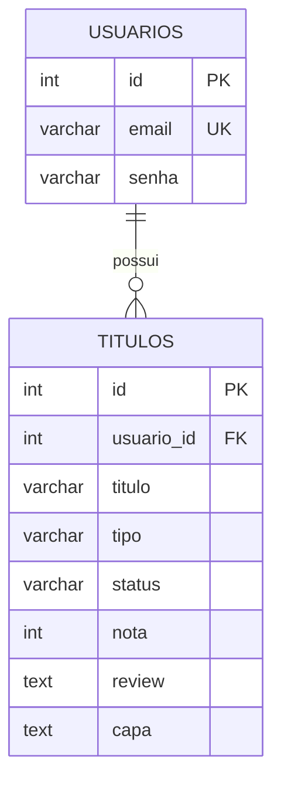

# StreamList

Aplicação web para organizar filmes e séries, desenvolvida em PHP e PostgreSQL. Cada usuário cria uma conta, monta a sua própria **vitrine** de títulos (com capa, status, nota e review) e acompanha o que quer assistir, está assistindo ou já assistiu. As capas são sugeridas automaticamente a partir da API do TMDB conforme o título é digitado.

## Funcionalidades

- Cadastro de usuário com e-mail e senha armazenada com `password_hash()`.
- Login e logout com sessão PHP.
- Proteção das páginas internas: visitantes não autenticados são redirecionados para o login.
- Cadastro de filme ou série com título, tipo, status, nota (1 a 10) e review.
- Sugestão de capas pela API do TMDB enquanto o título é digitado, com pré-visualização da capa escolhida.
- Vitrine com cartões que mostram capa, selo de status, nota, tipo e review.
- Filtro da vitrine por status (todos, quero assistir, assistindo, assistidos), com contador em cada aba.
- Busca de título pelo nome, combinável com o filtro de status.
- Edição de status, nota, review e capa de um título.
- Exclusão de título com tela de confirmação.
- Aviso quando o usuário tenta adicionar um título que já existe na sua vitrine.
- Isolamento entre usuários: cada pessoa só vê, edita e exclui os próprios títulos.
- Interface responsiva, que se adapta a telas de celular.

## Tecnologias

- PHP
- PostgreSQL
- PDO com o driver `pdo_pgsql`
- cURL (PHP) para consultar a API do TMDB
- JavaScript (`fetch`) para a busca de capas
- HTML
- CSS

## 1. Como Executar o Projeto

Os comandos abaixo funcionam em qualquer terminal Linux: servidor acessado pelo **MobaXterm (SSH)**, WSL, máquina virtual ou o próprio computador. No MobaXterm, basta abrir uma sessão SSH com o servidor e colar os comandos no terminal.

### 1.1 Pré-requisitos

- **PHP 7.4 ou superior** com as extensões:
  - `pdo_pgsql` (conexão com o PostgreSQL)
  - `curl` (consulta à API do TMDB)
- **PostgreSQL** instalado e em execução na porta padrão `5432`.
- **Git** instalado.
- Conexão com a internet (para buscar as capas no TMDB).

Para instalar tudo em Ubuntu/Debian:

```bash
sudo apt update
sudo apt install -y git php php-cli php-pgsql php-curl postgresql postgresql-contrib
```

Para conferir se as extensões estão ativas:

```bash
php -m | grep -E "pdo_pgsql|curl"
```

### 1.2 Passo 1: Clonar o repositório

```bash
# Clone este repositório (troque pela URL do seu repositório)
git clone https://github.com/joaohso19/streamlist.git

# Acesse a pasta do projeto
cd streamlist
```

> **Importante:** os links do sistema usam o caminho `/streamlist/...`. Por isso, a pasta do projeto **precisa se chamar `streamlist`**.

### 1.3 Passo 2: Criar o banco de dados e o usuário

1. Entre no PostgreSQL com o usuário administrador `postgres`:

```bash
sudo -u postgres psql
```

> Em Windows ou em instalações com senha para o `postgres`, use `psql -U postgres`.

2. Dentro do `psql`, crie o usuário da aplicação:

```sql
CREATE USER streamlist_user WITH PASSWORD 'stream';
```

3. Crie o banco de dados tendo esse usuário como dono:

```sql
CREATE DATABASE streamlist OWNER streamlist_user;
```

Se o banco já existir e você quiser recriá-lo do zero:

```sql
DROP DATABASE IF EXISTS streamlist;
CREATE DATABASE streamlist OWNER streamlist_user;
```

> **Atenção:** `DROP DATABASE` apaga todos os dados existentes. Faça isso somente se não precisar preservá-los.

4. Conecte-se ao banco criado e conceda as permissões ao usuário:

```sql
\c streamlist

GRANT ALL PRIVILEGES ON DATABASE streamlist TO streamlist_user;
GRANT ALL ON SCHEMA public TO streamlist_user;
GRANT ALL PRIVILEGES ON ALL TABLES IN SCHEMA public TO streamlist_user;
GRANT ALL PRIVILEGES ON ALL SEQUENCES IN SCHEMA public TO streamlist_user;

-- vale também para tabelas criadas no futuro
ALTER DEFAULT PRIVILEGES IN SCHEMA public GRANT ALL ON TABLES TO streamlist_user;
ALTER DEFAULT PRIVILEGES IN SCHEMA public GRANT ALL ON SEQUENCES TO streamlist_user;
```

> As permissões em `SEQUENCES` são necessárias porque os campos `id` usam `SERIAL`: sem elas o INSERT falha.

5. Saia do `psql`:

```sql
\q
```

### 1.4 Passo 3: Criar as tabelas (executar o `schema.sql`)

Com o terminal na pasta do projeto, execute o arquivo `schema.sql` já entrando com o usuário da aplicação:

```bash
# Se o schema.sql estiver na raiz do projeto
psql -U streamlist_user -h localhost -d streamlist -f schema.sql

# Se estiver dentro de uma pasta (ex.: database/)
psql -U streamlist_user -h localhost -d streamlist -f database/schema.sql
```

O PostgreSQL vai pedir a senha definida no passo anterior. O `-h localhost` força a conexão por senha, evitando erro de autenticação "peer".

Para conferir se as tabelas foram criadas:

```bash
psql -U streamlist_user -h localhost -d streamlist -c "\dt"
```

Resultado esperado: as tabelas `usuarios` e `titulos`.

> Se aparecer `permission denied for schema public` (PostgreSQL 15 ou superior), volte ao Passo 2 e confira o comando `GRANT ALL ON SCHEMA public`.

### 1.5 Passo 4: Configurar a conexão no PHP

1. Na pasta `database`, abra o arquivo `connect.php`:

```bash
nano database/connect.php
```

2. Altere as credenciais para as do seu ambiente:

```php
$host = 'localhost';
$port = '5432';
$dbname = 'streamlist';
$user = 'streamlist_user';
$password = 'troque_esta_senha';
```

> **Observação:** o usuário `streamlist_user` deve existir no PostgreSQL e ter permissão no banco `streamlist`. Não publique sua senha real no GitHub.

### 1.6 Passo 5: Primeiro acesso

1. Abra a tela de cadastro (`/streamlist/login/cadastrar.php`).
2. Informe e-mail e senha e clique em **Cadastrar**.
3. Você será redirecionado ao login; entre com a conta criada.
4. Use **Adicionar** para incluir o primeiro filme ou série.

### 1.7 Problemas comuns

| Erro | Causa provável | Solução |
|---|---|---|
| `could not find driver` | Extensão `pdo_pgsql` ausente | `sudo apt install php-pgsql` |
| `password authentication failed` | Senha ou usuário errado no `connect.php` | Conferir as credenciais |
| `permission denied for table` / `sequence` | Permissões não concedidas | Refazer os `GRANT` do Passo 2 |
| `Call to undefined function curl_init()` | Extensão `curl` ausente | `sudo apt install php-curl` |
| Capas não aparecem | Chave do TMDB inválida ou sem internet no servidor | Conferir `$chave` em `app/tmdb.php` |

---

## 2. Estrutura do Projeto

```
streamlist/
├── app/
│   ├── create.php        # adicionar título
│   ├── read.php          # vitrine (listagem, abas e busca)
│   ├── update.php        # editar título
│   ├── delete.php        # excluir título
│   └── tmdb.php          # busca de capas na API do TMDB
├── assets/
│   ├── style.css         # estilos (tema escuro)
│   └── capas.js          # busca e seleção de capas (JavaScript)
├── database/
│   └── connect.php       # conexão PDO com o PostgreSQL
├── includes/
│   ├── functions.php     # funções de acesso ao banco
│   ├── header.php        # cabeçalho comum
│   └── footer.php        # rodapé comum
├── login/
│   ├── login.php         # entrada do usuário
│   ├── cadastrar.php     # cadastro de usuário
│   └── verifica_user.php # protege as páginas (exige sessão)
├── schema.sql            # criação das tabelas
└── README.md
```

---

## 3. Regras de Negócio

### 3.1 Usuários e acesso

- **RN01** – O e-mail do usuário é único: não podem existir dois cadastros com o mesmo e-mail.
- **RN02** – A senha é armazenada criptografada (`password_hash`), nunca em texto puro.
- **RN03** – As páginas da vitrine (`create`, `read`, `update`, `delete`) só podem ser acessadas por usuário logado (verificação em `verifica_user.php`).
- **RN04** – Cada usuário enxerga, edita e exclui **somente os seus próprios títulos**. Todas as consultas filtram por `usuario_id`.
- **RN05** – Ao excluir um usuário, todos os seus títulos são excluídos junto (`ON DELETE CASCADE`).

### 3.2 Títulos

- **RN06** – Todo título possui nome, tipo (`filme` ou `serie`) e status.
- **RN07** – O status pode ser `quero` (quero assistir), `assistindo` ou `assistido` (já assisti).
- **RN08** – A **nota** (1 a 10) só vale para os status `assistindo` e `assistido`. Quando o status é `quero`, o campo de nota fica oculto e a nota é gravada como vazia (`NULL`).
- **RN09** – A nota é opcional; se o campo ficar em branco, é gravada como `NULL`.
- **RN10** – Não é permitido cadastrar duas vezes o mesmo título para o mesmo usuário: a comparação considera o **nome (sem diferenciar maiúsculas e minúsculas) e o tipo**. Nesse caso, é exibida a mensagem *"Você já adicionou esse título na sua vitrine."*
- **RN11** – O comentário (review) e a capa são opcionais.
- **RN12** – Na edição, é possível alterar status, nota, review e capa. O nome e o tipo do título **não** podem ser alterados.
- **RN13** – A exclusão exige uma tela de confirmação antes de remover o título.

### 3.3 Vitrine

- **RN14** – A vitrine lista os títulos do mais recente para o mais antigo (`ORDER BY id DESC`).
- **RN15** – As abas **Todos**, **Quero assistir**, **Assistindo** e **Assistidos** filtram a lista por status e mostram a quantidade de títulos de cada uma.
- **RN16** – A busca por título ignora maiúsculas/minúsculas e funciona em conjunto com a aba escolhida.
- **RN17** – Quando não há resultado, o sistema informa que nenhum título foi encontrado ou convida o usuário a adicionar o primeiro.

### 3.4 Capas (API TMDB)

- **RN18** – A busca de capas só começa após o usuário digitar pelo menos **2 caracteres**, com espera de 400 ms após a última tecla.
- **RN19** – A busca é feita primeiro no tipo escolhido (filme ou série); se nada for encontrado, o sistema tenta o outro tipo.
- **RN20** – São exibidas no máximo **6 capas**, e o usuário escolhe uma clicando nela. A capa escolhida aparece no preview e é salva como URL.
- **RN21** – Se a API estiver indisponível, o sistema avisa o usuário e permite salvar o título sem capa.

---

## 4. Product Backlog

**Legenda de prioridade:** Alta · Média · Baixa

### 4.1 Entregue

| ID | Como... | Quero... | Para... | Prioridade |
|---|---|---|---|---|
| US01 | visitante | me cadastrar com e-mail e senha | ter minha própria vitrine | Alta |
| US02 | usuário | fazer login | acessar meus títulos com segurança | Alta |
| US03 | usuário | adicionar um filme ou série informando título, tipo e status | registrar o que quero ver | Alta |
| US04 | usuário | ver minha vitrine com as capas dos títulos | visualizar meu catálogo de forma agradável | Alta |
| US05 | usuário | filtrar a vitrine por status (abas com contagem) | encontrar rápido o que estou assistindo | Alta |
| US06 | usuário | editar status, nota, review e capa de um título | manter minhas informações atualizadas | Alta |
| US07 | usuário | excluir um título com confirmação | remover o que não quero mais sem errar | Média |
| US08 | usuário | dar nota de 1 a 10 apenas em títulos que já vi ou estou vendo | avaliar de forma coerente | Média |
| US09 | usuário | escrever um comentário (review) sobre o título | registrar minha opinião | Média |
| US10 | usuário | escolher a capa entre opções buscadas automaticamente na API | não precisar procurar imagens manualmente | Média |
| US11 | usuário | buscar um título pelo nome na vitrine | encontrar rápido em listas grandes | Média |
| US12 | usuário | ser avisado ao tentar adicionar um título repetido | evitar duplicidade na vitrine | Média |

### 4.2 Ideias futuras

| ID | Como... | Quero... | Para... | Prioridade |
|---|---|---|---|---|
| US13 | usuário | ordenar a vitrine por nota ou por nome | organizar a lista do meu jeito | Baixa |
| US14 | usuário | ver estatísticas (total assistido, nota média) | acompanhar meu histórico | Baixa |
| US15 | usuário | recuperar minha senha | acessar a conta caso esqueça | Baixa |
| US16 | usuário | paginação na vitrine | navegar melhor com muitos títulos | Baixa |

---

## 5. Estrutura do Banco de Dados

**SGBD:** PostgreSQL · **Banco:** `streamlist`

### 5.1 Diagrama de relacionamento



Relacionamento **1:N** – um usuário possui vários títulos; cada título pertence a um único usuário.

### 5.2 Tabela `usuarios`

| Coluna | Tipo | Restrições | Descrição |
|---|---|---|---|
| `id` | `SERIAL` | PRIMARY KEY | Identificador do usuário |
| `email` | `VARCHAR(150)` | NOT NULL, UNIQUE | E-mail usado no login |
| `senha` | `VARCHAR(255)` | NOT NULL | Senha criptografada (hash) |

### 5.3 Tabela `titulos`

| Coluna | Tipo | Restrições | Descrição |
|---|---|---|---|
| `id` | `SERIAL` | PRIMARY KEY | Identificador do título |
| `usuario_id` | `INT` | NOT NULL, FOREIGN KEY → `usuarios(id)` ON DELETE CASCADE | Dono do título |
| `titulo` | `VARCHAR(200)` | NOT NULL | Nome do filme ou série |
| `tipo` | `VARCHAR(10)` | NOT NULL, CHECK (`filme`, `serie`) | Tipo do título |
| `status` | `VARCHAR(10)` | NOT NULL, CHECK (`quero`, `assistindo`, `assistido`) | Situação do título |
| `nota` | `INT` | CHECK entre 1 e 10 (aceita `NULL`) | Nota dada pelo usuário |
| `review` | `TEXT` | opcional | Comentário do usuário |
| `capa` | `TEXT` | opcional | URL da capa (TMDB) |

### 5.4 Script de criação (`schema.sql`)

```sql
CREATE TABLE IF NOT EXISTS usuarios (
    id SERIAL PRIMARY KEY,
    email VARCHAR(150) NOT NULL UNIQUE,
    senha VARCHAR(255) NOT NULL
);

CREATE TABLE IF NOT EXISTS titulos (
    id SERIAL PRIMARY KEY,
    usuario_id INT NOT NULL REFERENCES usuarios(id) ON DELETE CASCADE,
    titulo VARCHAR(200) NOT NULL,
    tipo VARCHAR(10) NOT NULL CHECK (tipo IN ('filme', 'serie')),
    status VARCHAR(10) NOT NULL CHECK (status IN ('quero', 'assistindo', 'assistido')),
    nota INT CHECK (nota BETWEEN 1 AND 10),
    review TEXT,
    capa TEXT
);
```

---

## 6. Tecnologias Utilizadas

- **PHP** (back-end, PDO para acesso ao banco)
- **PostgreSQL** (banco de dados relacional)
- **HTML, CSS e JavaScript** (interface e busca de capas com `fetch`)
- **API do TMDB** (capas de filmes e séries)
- **Git/GitHub** (versionamento)

```
